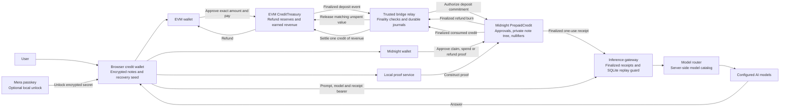

# ShadowCompute

**One prepaid AI balance. Multiple models. Private credit spending. Refundable unused credits.**

ShadowCompute accepts a supported test stablecoin into an EVM treasury, issues matching credit entitlements on Midnight, and lets a user spend those credits on a configured AI model. Unspent credits can be burned on Midnight for a matching treasury refund. A consumed credit becomes service revenue.

The current product is **prepaid AI**, with no APY, lending strategy or yield promise. Aave is not part of this architecture. The earlier simulated-yield implementation remains available for existing notes and recorded demos.

This is a testnet prototype. The current bridge deployment uses a dedicated local Anvil chain and an actual local Midnight node/proof server. Its ERC20 is a valueless test token, not native USDC. Sepolia is supported by the source treasury/network guard, but a complete public Sepolia → Midnight Preview deployment has not been verified. The first relay is explicitly trusted; this is not a trustless bridge or a Circle CCTP integration.

**Hosted interface:** https://shadowcompute.vercel.app · **Public source:** https://github.com/wolf1276/shadowcompute

The hosted interface pairs explicitly with the local demo companion on this computer. Start it with `TERMINAL_ALLOWED_ORIGIN=https://shadowcompute.vercel.app npm run terminal:prepaid`, open http://localhost:8792/pair, and enter its private code on the hosted site. Proofs, GPU inference and durable state stay local. See [deployment and recovery instructions](docs/VERCEL_DEPLOYMENT.md). This is not a publicly hosted inference backend or a new public-chain contract deployment. Local demo services are stopped between demos to free RAM/GPU.

## Architecture



### Components and responsibilities

| Component | Responsibility | Implementation |
|---|---|---|
| Browser credit wallet | Credit purchase, encrypted note custody, model selection, requests, refunds, backup and recovery | [`prepaid.js`](packages/terminal/prepaid.js), [`prepaid-notes.js`](packages/terminal/prepaid-notes.js), [`app.js`](packages/terminal/app.js) |
| Passkey unlock | Wrap and locally recover the existing note-store unlock secret using WebAuthn PRF; password recovery stays available | [`vault-passkey.js`](packages/terminal/vault-passkey.js), [`vault-store.js`](packages/terminal/vault-store.js), Mera 0.2.0 |
| Source treasury | Hold the selected ERC20; reserve unused-credit liabilities; release attested refunds; collect only consumed-credit revenue | [`CreditTreasury.sol`](packages/bridge-evm/src/CreditTreasury.sol) |
| Bridge relay | Verify source chain, treasury, asset, destination and finalized payment; authorize Midnight issuance; settle finalized burns/consumption | [`credit-treasury.ts`](packages/backend/src/credit-treasury.ts), [`prepaid-relay.ts`](packages/backend/src/prepaid-relay.ts) |
| Midnight credit contract | One approval per deposit, private balance commitments, membership proofs, one-use nullifiers, request receipts and refund records | [`prepaid-credit.compact`](packages/contracts/contract/prepaid-credit.compact) |
| Wallet transaction bridge | Return serialized balance/submit requests to the connected Midnight wallet and track actual operation stages | [`wallet-jobs.ts`](packages/backend/src/wallet-jobs.ts), [`prepaid-vault.ts`](packages/backend/src/prepaid-vault.ts) |
| Inference gateway | Validate finalized receipt/bearer binding; persist admission, same-request replay, retries and uncertain outcomes | [`gateway.ts`](packages/backend/src/gateway.ts), [`receipt-source.ts`](packages/backend/src/receipt-source.ts) |
| Model router | Route an allowlisted model ID to its configured adapter without exposing credentials | [`models.ts`](packages/backend/src/models.ts), [`models.local.json`](config/models.local.json) |

## Payment and credit lifecycle

### 1. Secure the credit wallet

The user connects a Midnight wallet and opens the credit wallet on a stable hostname such as `http://localhost:8792`. Browser notes use the existing PBKDF2-SHA-256/AES-GCM store, bound to the network, credit-contract address and wallet account. Mera passkey enrollment is optional after password unlock. A saved compatible passkey becomes the main unlock action; the recovery password remains available.

The user creates a private recovery seed for each payment and saves an encrypted payment backup **before paying**. The seed deterministically derives later note salts so an original payment backup can recover subsequent unspent balance. Recent backups are still needed to preserve request history and pending-operation details. Wallet or passkey possession alone does not recover deleted note ciphertext.

### 2. Pay the source treasury

The browser prepares a commitment to the private credit note, including its quantity and destination contract. The EVM wallet approves the exact supported-token amount, then calls `CreditTreasury.deposit(credits, ownerCommitment)`.

The treasury checks initialization, quantity, a previously unused commitment, and the exact token balance increase. It rejects taxed-transfer behavior and duplicate payment commitments. Its deposit event identifies the payer, payment ID, committed recipient, quantity, amount and Midnight contract. Amounts and source transactions are public.

The demo price is fixed at deployment: **10,000 smallest units of a 6-decimal test token per credit**, or `0.01 tUSD`. This is an illustrative test price, not a measured commercial inference price. All configured demo models currently cost one credit per authorized request.

### 3. Authorize and claim Midnight credits

The relay verifies the RPC chain ID, configured treasury, asset, price, linked Midnight instance, successful transaction receipt, canonical block hash and source finality. An inclusion receipt alone is insufficient.

It then calls `authorizeDeposit` with the original payment ID, committed note and exact funded quantity. The contract records that payment ID permanently to prevent another authorization. The user proves the note opening through `claimDeposit`; the contract checks that its committed balance equals the approved quantity before adding the note to its Merkle tree.

These are app-issued private credit entitlements. Stablecoins remain in the EVM treasury; the protocol does not mint native USDC on Midnight.

### 4. Select a model and spend one credit

The browser reads the public model catalog from the gateway/terminal session. The current local catalog includes Qwen 0.5B text and Qwen Coder 7B text through the local chat-completions API, plus a skill-guided OpenCode/Compact compiler profile. General text routes do not receive the Compact-only skill. Hosted adapters require explicit operator configuration and credentials; no paid fallback is selected automatically.

To authorize a request, the user proves ownership and membership of a positive-balance note. `redeem` marks its nullifier spent, creates a note with one fewer credit and a new salt, and publishes a short-lived receipt bound to a separate bearer secret. A zero-balance successor is also committed so the public tree update does not directly reveal that the last unit was spent.

The gateway checks the receipt at Midnight's finalized head and verifies the bearer binding. New model-selected requests are bound to **both model ID and prompt** in SQLite. The same request returns its cached answer or follows the existing retry policy; another model or prompt cannot reuse that paid receipt. Older requests without a model ID retain their legacy replay format.

A credit is consumed when its request authorization is proved, not only when generation succeeds. Known failures can retry the same paid request; uncertain provider outcomes require reconciliation. Compiler checking establishes syntax/type acceptance, not behavior or security.

### 5. Settle consumed-credit revenue

A durable relay queue discovers finalized request receipts and submits one source-chain consumption settlement per receipt. The treasury reduces refundable liability by one credit and increases earned revenue by its fixed token price. Settlement IDs are replay protected and bound to the Midnight instance.

Revenue collection always pays the immutable revenue recipient. It cannot withdraw the stablecoins reserved for unused credits. Settlement can lag model execution: the operator fronts inference cost while matching value remains reserved until the source settlement finalizes.

### 6. Refund unused credits

The user chooses an EVM recipient and proves `requestRefund` for the remaining balance of one note. The contract consumes that note, records the recipient and quantity publicly, and removes those units from outstanding credits. The same note cannot also authorize another request.

The relay reads the finalized refund record and calls the source treasury. The treasury verifies the relay, rejects a replay, reduces its refundable liability and transfers the exact matching test-token amount. Refunds are whole-note operations; multiple purchase notes can be refunded separately. Spent credits are not refundable through this path.

## Accounting invariants

Let `p` be the fixed token price per credit.

- Each accepted source payment reserves `credits × p` token units.
- Midnight funded units are partitioned into pending approvals, outstanding private balance, consumed units and refund-burned units.
- Source consumption settlement moves `p` from refundable liability to earned revenue.
- Source refund settlement transfers `refundedCredits × p` and reduces refundable liability by that quantity.
- Revenue collection is limited to earned revenue; there is no generic reserve sweep.
- With the supported fixed-balance token and correct relay attestations, treasury token balance must cover `refundableCredits × p + earnedRevenue` before revenue collection.

The EVM contract does not independently verify a Midnight light-client proof. Correct cross-chain issuance/refund/consumption depends on the configured relay and its RPC/finality checks. A malicious relay can violate backing by attesting false consumption or refunds. Production use requires a stronger attestation/security design and independent review.

## Recovery and interruption handling

Every money-moving browser operation saves an encrypted journal before requesting wallet action. Relay approvals and source settlements have owner-only durable journals. The application preserves unknown submissions and their original hashes rather than blindly paying or issuing again.

- Payment submitted without a returned hash: recover the matching commitment event or provide the existing EVM transaction hash. The treasury rejects a second payment with the same commitment.
- Midnight response lost: reconcile commitment/nullifier state and reconstruct deterministic successor notes before replacing local state.
- Old payment backup restored: search the finalized note commitments for the latest derived sequence and recover its unspent balance.
- Refund burn finalized but source transfer pending: resume the existing source settlement, using its saved hash/replay key.
- Inference interrupted: retry the same saved receipt, model and prompt. Never redeem another credit just to retry.
- Source or Midnight chain reset: preserve the old manifest and notes; do not relabel them as a new deployment.

Keep one canonical durable gateway database for each credit-contract deployment. The demo and running service must share it; replacing the replay database can admit old receipts again. Preserve that database on restarts alongside relay journals.

Do not delete `.pending` journals after a timeout. A chain transaction may have finalized without returning to the client. A journal with an unknown source submission and no transaction hash needs explicit reconciliation.

## Privacy and custody boundaries

| Party or location | What it can see or control |
|---|---|
| EVM wallet/source chain | Public funding address, treasury, token, payment quantity, commitments, refunds and timing |
| Midnight wallet | Wallet keys, balances and transaction approvals; keys stay in the extension |
| Browser | Decrypted credit notes, recovery seeds, bearer credentials and request history while unlocked |
| Mera authenticator | Passkey operations and PRF evaluation; the encrypted wrapper stays in the browser/backup |
| Trusted local app and proof server | Note openings needed to construct proofs; this is not browser-only proving |
| Public Midnight ledger | Payment approvals, commitments, nullifiers, aggregate counters, receipt expiry and refund recipient/quantity |
| Bridge operator | Source/destination mapping and attestation authority; stablecoin reserve safety depends on correct behavior |
| Gateway and selected model | Prompt, response, selected model and anonymous receipt credential; request content is not cryptographically hidden from them |

A small anonymity set, public amounts, refund records and timing allow correlation. Passkey unlock is local secret decryption, not backend account authentication or Midnight transaction signing. Password recovery remains an alternative unlock route and retains its offline-guessing risk. Protect the browser, OS, recovery password and latest backup. Never expose the loopback wallet/proof bridge publicly.

## Run the prepaid development environment

Requirements: Node 24+, npm 11.21.0, Foundry (`forge`, `anvil`), Docker Compose, Compact compiler 0.36.1 and the pinned Ledger 9 stack in [`toolchain.json`](toolchain.json).

```sh
npx --yes npm@11.21.0 ci
cp .env.example .env
# Set PRIVATE_STATE_PASSWORD. Preserve any existing .env and deployment state.
npm run env:up
# Fresh checkout only; do not regenerate keys for an active deployment.
npm run compile
npm run test:treasury
npm test
npm run typecheck
```

Use a dedicated local EVM chain; do not reset a chain holding an existing treasury deployment:

```sh
anvil --host 127.0.0.1 --port 18545 --chain-id 31337 \
  --block-time 1 --state .private-states/prepaid-anvil.json --state-interval 10
npm run deploy:prepaid:local
npm run gateway:prepaid
# In another terminal:
npm run terminal:prepaid
```

Open **http://localhost:8792**. Use an EVM wallet for source payment/refund and a Midnight wallet for credit proofs. The local-only faucet can supply valueless test tokens and gas to the selected EVM wallet. A public Sepolia configuration needs its own test gas, supported test token, treasury deployment and relay key; local faucet methods are disabled there.

A local rehearsal is available as `npm run demo:prepaid` on an idle instance with zero pending/outstanding credits, source refund liabilities and uncollected revenue. It uses the canonical gateway database. Pause the idle terminal's settlement worker while rehearsing, then restart it. Completed instances can be rehearsed again: each run records its initial aggregate counters and checks exact increments. Preserve the recovery file if interrupted; resume with `npm run demo:prepaid -- --resume PATH_TO_PRIVATE_RECOVERY_FILE`. Use `PREPAID_EVIDENCE_FILE` to keep a fresh run separate from earlier evidence.

The deployment writes [`artifacts/deployment.prepaid.local.json`](artifacts/deployment.prepaid.local.json), a gitignored `.env.prepaid`, private issuer state and a recovery journal. Existing deployment/journal files block a blind redeployment. Never recompile active contract keys underneath a deployed instance or running proof.

| Service | Local endpoint |
|---|---|
| Prepaid UI | `http://localhost:8792` |
| Prepaid inference gateway | `http://127.0.0.1:8789` |
| Dedicated test EVM RPC | `http://127.0.0.1:18545` |
| Midnight node | `http://127.0.0.1:9944` |
| Midnight indexer | `http://127.0.0.1:8088` |
| Midnight proof server | `http://127.0.0.1:6300` |
| Local GPU model API | `http://127.0.0.1:11435` |

For the existing local model, use the documented runtime scripts:

```sh
npm run ai:gpu
# In another terminal, if model weights are not already present:
npm run ai:coder:pull
npm run ai:coder:configure
```

The model catalog is [`config/models.local.json`](config/models.local.json). Provider credentials are referenced from server environment variables and never included in the browser catalog. Live capability metadata comes from gateway health; restart an idle terminal after changing its gateway catalog.

## Verification and limits

- The source treasury has unit/fuzz checks for reserved refund liabilities, earned revenue, authorization, duplicate messages/payments, invalid quantities, taxed transfers and mainnet deployment rejection.
- Compact simulator checks cover funded claim amounts, ownership/membership, replay, private balance rotation, final-credit spending and refund conservation. Simulator execution does not establish proof acceptance.
- Real proving/verifying keys have been generated for the new prepaid circuits, and the local source treasury and Midnight credit contract have been deployed.
- The complete local prepaid rehearsal passed: **5 credits purchased, 2 authorized across two actual local models, 3 unused credits refunded**, with zero outstanding credit liability and zero remaining treasury token balance after collecting earned revenue. It checked source finality, deposit/refund replay, model-switch replay rejection, cached retries and recovery of the remaining balance from the original payment seed. See [`artifacts/prepaid-e2e.json`](artifacts/prepaid-e2e.json).
- A fresh additional cycle on the existing idle instance also passed: four new automated wallet approvals, two uncached live model calls, cached identical retries and three-credit refund. See [`artifacts/prepaid-e2e.fresh.json`](artifacts/prepaid-e2e.fresh.json). The text coder's answer was incorrect; this evidence proves authorization/accounting and transport, not code quality.
- The consolidated JavaScript/Compact/HTTP suite has **66 passing tests across 18 files**. The EVM treasury has **11 passing tests**, including a 128-case solvency fuzz test. TypeScript, browser JavaScript syntax and HTML/control-ID checks pass.
- The rehearsal recovered an included-but-not-finalized source payment and an interrupted local model service using the existing payment and paid receipt. Failed attempts are retained; they are not counted as successful runs.
- Model transport and credit accounting were exercised separately from answer quality. Recorded local-model answers include instruction-following/code errors. General text models use the local chat-completions route; [`artifacts/prepaid-model-routing.json`](artifacts/prepaid-model-routing.json) records that separate routing check. These demo models are not a guarantee of correct answers.
- [`artifacts/browser-vault-local.json`](artifacts/browser-vault-local.json) and [`artifacts/opencode-compact-demo.json`](artifacts/opencode-compact-demo.json) document earlier real wallet/proof and local-AI evidence for the legacy flow; they do not prove the new prepaid bridge or an installed extension walkthrough.
- Real Brave/passkey hardware, the complete public Sepolia/Preview bridge, production operations, commercial pricing and independent security review remain open gates. Test-token payments do not finance real-world provider bills. The last dependency audit reported 26 moderate findings and no high/critical findings.

## Public prepaid deployment preparation

The Sepolia → Preview workflow is ready for configuration, with submission pending by request. See [`docs/PUBLIC_PREPAID_DEPLOYMENT.md`](docs/PUBLIC_PREPAID_DEPLOYMENT.md). Run `npm run preflight:prepaid:preview` for a read-only check; it currently reports the missing Sepolia RPC/key. No new public prepaid contracts are claimed.

Business hypotheses, measured model latency/energy boundaries and the interview worksheet are in [`docs/BUSINESS_VALIDATION.md`](docs/BUSINESS_VALIDATION.md).

## Legacy simulated-yield compatibility

The earlier `shadow-vault.compact`, test-token faucet, local/Preview manifests and encrypted notes remain intact. That implementation has a sponsor-funded reserve and administrator-controlled simulated clock. It does not demonstrate real lending returns. Existing commands remain available:

```sh
npm run gateway
npm run terminal                 # localhost:8790
npm run gateway:preview
npm run terminal:preview         # localhost:8791
npm run test:wallet
npm run test:local
```

Legacy notes belong to their original network, wallet and contract. They are not silently converted into prepaid credits. Keep their backups and pending journals during migration.

## Project map and further documentation

- [`creditsintegration.md`](creditsintegration.md): prepaid implementation checklist and current decisions.
- [`meraintegration.md`](meraintegration.md): passkey integration, recovery and hardware acceptance gate.
- [`docs/RUNBOOK.md`](docs/RUNBOOK.md): operational recovery, journals and retries.
- [`docs/TEST_MATRIX.md`](docs/TEST_MATRIX.md): checks and evidence boundaries.
- [`docs/PROGRESS.md`](docs/PROGRESS.md): historical implementation and actual verification.
- [`docs/PROJECT_SCORECARD.md`](docs/PROJECT_SCORECARD.md): current project-wide quality and viability gates.
- [`THIRD_PARTY.md`](THIRD_PARTY.md): upstream code and license attribution.
